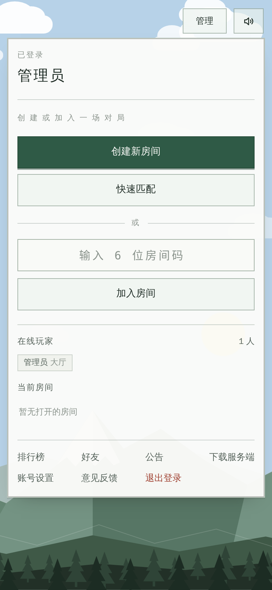
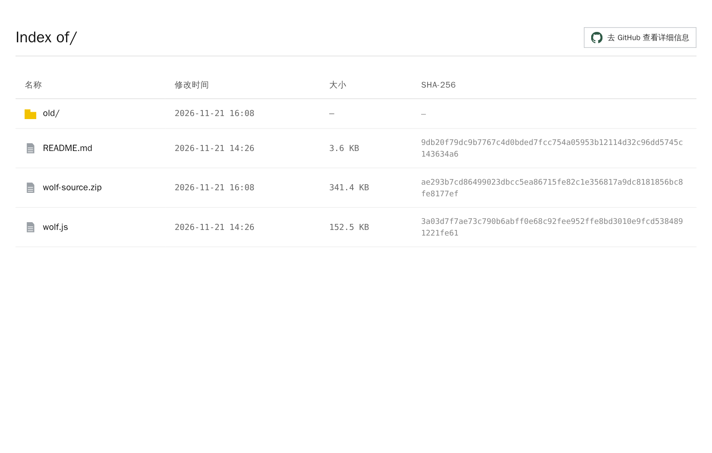

# 狼人杀 

## 一、项目概述

### 1. 项目简介

`wolf.js` 是一套可以自己部署的轻量狼人杀服务，服务端入口在 `wolf.js`，页面骨架、样式和前端脚本在 `public/`，下载页、部署页和历史版本页的路由在 `server/pages.js`

- 支持 4 到 8 人房间，包含狼人、好人、投票、夜晚行动和主持人流程；
- 支持账号注册、登录、头像、个性签名、排行榜、好友、私聊和近 10 场战绩；
- 支持房主邀请好友、拒绝玩家加入，以及房间内文字聊天和语音聊天；
- 支持 DeepSeek 机器人，由房主决定是否开启，也可以随时关闭；
- 背景音乐、按键音效、白天和夜晚主题都在前端本地加载；
- 不依赖外部数据库服务，账号和对局数据保存在本地 SQLite 文件中

### 2. 页面展示

以下为实际运行截图：

#### 大厅



#### 房间


#### 玩家名片


#### 管理界面


#### 下载页



### 3. 文件目录说明

| 文件或目录 | 用途 |
| --- | --- |
| `wolf.js` | 服务端入口，负责 Express、Socket.IO 和游戏逻辑 |
| `server/pages.js` | 下载页、部署页、历史版本页和静态资源路由 |
| `public/index.html` | 页面骨架 |
| `public/app.css` | 页面样式 |
| `public/app.js` | 前端脚本 |
| `package.json` | Node 依赖配置 |
| `audio/` | 背景音乐和按键音效 |
| `assets/` | GitHub 图标和截图 |
| `notice.txt` | 游戏内更新公告，唯一公告来源 |
| `admin.ini` | 管理员配置 |
| `old/` | 历史版本源码 |
| `source/wolf-source.zip` | 当前版本的完整源码包 |
| `更新说明.md` | 每个版本的改动记录 |

### 4. 首次运行生成的文件

首次启动会自动创建以下文件，不需要手动新建：

| 文件或目录 | 用途 |
| --- | --- |
| `admin.ini` | 管理员账号配置，首次启动默认账号和密码都是 `admin` |
| `data/accounts.db` | 账号、战绩和历史对局记录 |
| `data/avatars.db` | 玩家头像 |
| `data/social.db` | 好友关系和私聊记录 |
| `data/chat.db` | 房间聊天记录 |
| `wolf.log` | 服务端运行日志 |

### 5. 运行环境

| 项目 | 要求 |
| --- | --- |
| Node.js | 18 或更新版本，推荐 Node 20/22 LTS |
| 操作系统 | Termux、Linux、macOS、Windows |
| 默认端口 | `8080` |
| 数据库 | 本地 SQLite，不需要额外安装数据库服务 |

---

## 二、本地部署

### 1. 安装环境

Termux 安装 Node 和解压工具：

```bash
pkg update
pkg install nodejs unzip
```

Windows 安装 Node.js LTS 后，在 PowerShell 里确认：

```powershell
node -v
npm -v
```

### 2. 解压

Linux 或 Termux：

```bash
mkdir -p ~/wolf
unzip -o ~/wolf/wolf.zip -d ~/wolf （以实际路径为准，下同）
cd ~/wolf
```

Windows PowerShell：

```powershell
Expand-Archive -Path .\wolf.zip -DestinationPath .\wolf -Force
cd .\wolf
```

确认目录里至少有：

```text
wolf.js
server/pages.js
public/index.html
public/app.css
public/app.js
package.json
```

`audio/`、`assets/` 也建议一起保留，否则没有声音和 GitHub 图标

### 3. 安装依赖

```bash
npm install
```

`bcrypt` 和 `sqlite3` 带原生二进制，Termux、Linux、Windows 之间不能直接复制 `node_modules`，每个系统都要重新安装

### 4. 启动

Linux、Termux 和 Windows 命令相同：

```bash
node wolf.js
```

默认端口是 `8080`。浏览器打开：

```text
http://127.0.0.1:8080
```

手机和电脑在同一个 Wi-Fi 时，用电脑的局域网 IP 访问，例如：

```text
http://192.168.1.10:8080
```

Windows 第一次启动如果弹出防火墙提示，允许 Node 访问局域网。

只替换 `wolf.js` 不够，202611211330 起必须保留 `server/` 和 `public/`，否则会报 `Cannot find module './server/pages'`

### 5. 管理员

- 账号：`admin`
- 首次启动默认密码：`admin`

启动后终端会提醒修改默认密码，打开根目录 `admin.ini`，修改：

```ini
password=你的新密码
```

保存后重启 `node wolf.js`，新密码会自动写入管理员账号。

如果忘记密码，把 `admin.ini` 里的 `firstrun` 改成 `true`，重启会恢复默认 `admin`，登录后再改

---

## 三、更新方式

从 202611211330 起必须整包解压。至少覆盖 `wolf.js`、`server/`、`public/`、`audio/` 和 `notice.txt`，再重启 Node。

下载页里的 `wolf-source.zip` 是当前版本的完整源码，解压后可以直接运行。

只替换 `wolf.js` 会缺少 `server/pages.js` 和 `public/`，服务直接起不来。页面样式和脚本已经从 `wolf.js` 拆到 `public/`，改完也必须重启进程重新读入<

## 四、历史版本

归档源码都在 `old/` 目录，下载页点 `old/` 可以直接下载

## 五、安全说明

- 首次登录后尽快修改默认管理员密码；
- 公网部署建议加 HTTPS 和反向代理访问控制；

